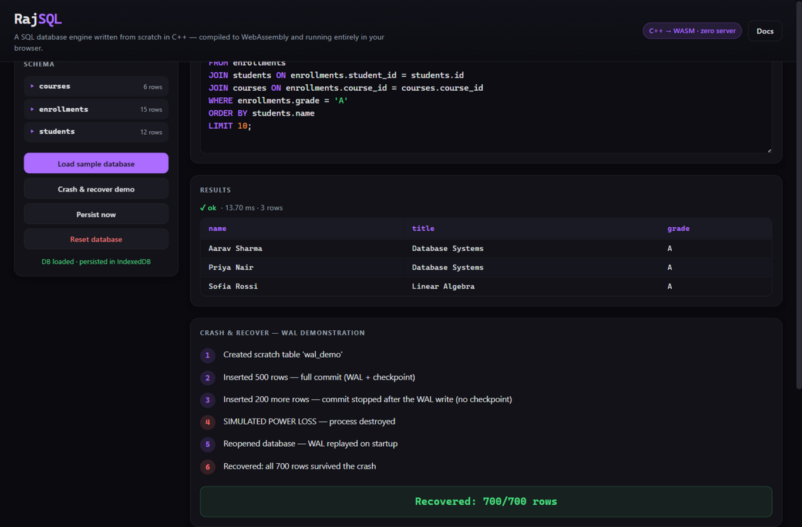

# RajSQL

**RajSQL: a SQL database engine written from scratch in C++, compiled to WebAssembly, running in your browser.**

No dependencies. No existing database library. Just C++17: a lexer, a parser, a paged storage engine, a B+tree, and a write-ahead log, compiled with Emscripten so you can create tables, run joins, and crash-recover a database inside a browser tab.

[](https://github.com/rajpalgelot-tech/RG-sql/actions/workflows/ci.yml)
[](LICENSE)


New here? Read the [simple guide](GUIDE.md): what RajSQL is for, how to use the playground step by step, and what every button does, in plain language.

## Live demo

Open the playground and start typing SQL:

**https://rajpalgelot-tech.github.io/RG-sql/**



*The playground running a 3-table INNER JOIN and the "Crash & recover" WAL demo, both executed by the same C++ engine compiled to WebAssembly.*

## Why build a database from scratch?

Databases are usually black boxes: you write SQL, rows come back. But the interesting engineering is all below the surface: how data is laid out on fixed-size pages, how a B+tree turns a search into a handful of I/Os, and how a write-ahead log makes a commit survive a power failure. RajSQL is an attempt to build that layer end to end, with no shortcuts: the pager talks to the file system byte by byte, the B+tree manages its own page splits and tombstone deletes, and durability is implemented the way real engines do it: log first, commit record, checkpoint, truncate. Building it teaches you what `COMMIT` actually means.

## Features

- Hand-written SQL lexer and recursive-descent parser producing an AST
- 4 KiB paged storage engine with an in-memory page cache
- Disk-backed B+tree (sorted leaf pages, leaf chains for range scans, tombstone deletes)
- Write-ahead log (WAL) with a 4-step commit protocol and automatic crash recovery
- Transactions: `BEGIN` / `COMMIT` / `ROLLBACK`
- Aggregates, `ORDER BY`, `LIMIT`, `INNER JOIN ... ON`
- Implicit `rowid` column on every table
- Runs natively (CLI) and in the browser via a WebAssembly build with an `extern "C"` JSON API

### Supported SQL

| Statement | Example |
|---|---|
| `CREATE TABLE` | `CREATE TABLE users (id INTEGER, name TEXT, score REAL)` |
| `DROP TABLE` | `DROP TABLE users` |
| `INSERT` | `INSERT INTO users VALUES (1, 'ada', 9.5)` |
| `SELECT` / `WHERE` | `SELECT name FROM users WHERE score > 5` |
| `ORDER BY` / `LIMIT` | `SELECT * FROM users ORDER BY score DESC LIMIT 10` |
| Aggregates | `SELECT COUNT(*), AVG(score) FROM users` |
| `INNER JOIN` | `SELECT * FROM users INNER JOIN orders ON users.id = orders.user_id` |
| `UPDATE` | `UPDATE users SET score = 10 WHERE id = 1` |
| `DELETE` | `DELETE FROM users WHERE id = 1` |
| Transactions | `BEGIN` · `COMMIT` · `ROLLBACK` |

Types: `INTEGER`, `REAL`, `TEXT`. Deletes are tombstones (marked, not erased); every row has an implicit `rowid`; the WAL replays committed transactions after a crash.

## Architecture

```
                 SQL text
                    |
                    v
               +---------+     tokens
               |  Lexer  |------------------+
               +---------+                  v
                                    +-------------+   AST
                                    |   Parser    |---------+
                                    +-------------+         v
                                                        +----------+
                          rows / catalog  +-------------| Executor |
                                          |             +----------+
                                          v
                                 +------------------+
                                 |   Pager (4 KiB   |
                                 |  pages + cache)  |
                                 +-----+-------+----+
                                       |       |
                    B+tree leaf/interior pages |
                    (data file, .db)           |
                                       |       v
                                 +------------------+
                                 |   WAL (.db.wal)  |
                                 +------------------+
```

### Crash recovery explained

Every write transaction goes through a 4-step commit protocol:

1. **Log pages**: every modified page is appended to the WAL file *before* being written back to the data file.
2. **COMMIT record**: a commit marker is appended and flushed; from this instant the transaction is durable.
3. **Checkpoint**: the logged pages are written to the data file.
4. **Truncate**: the WAL is truncated; the data file is now the sole source of truth.

On open, the engine inspects the WAL. If a COMMIT record is present, it replays the logged pages (redo). If pages appear after the last commit (a crash mid-checkpoint), they are discarded. An uncommitted transaction never survives, which is exactly what `ROLLBACK` relies on too.

The browser playground has a **"Crash & recover"** button: it kills the WASM instance mid-transaction (skipping the checkpoint step), reopens the database, and shows the recovered state, with committed transactions intact and uncommitted work gone.

### B+tree internals

Each 4 KiB page is either a leaf or an interior node:

```
Leaf page:      [ header | cell | cell | cell | ... ]
                  cell = (rowid, key, value). Deleted cells are
                  kept as tombstones and skipped by scans.

Interior page:  [ header | child ptr | min-key | child ptr | ... ]
                  min-keys route a search down to the right child.

Leaf chain:     leaves are linked left-to-right so full scans and
                range queries walk a single chain without touching
                the interior levels.
```

Honest v1 limitations:

- **No delete rebalancing**: deleted rows become tombstones; pages are reclaimed logically, not compacted (a scan never gets slower than linear in tombstones, but space is not reused within a page).
- **A row must fit a single page**: values larger than what remains in a 4 KiB page are not split across overflow pages.

## Build & run

**Prerequisites:** Docker (recommended, no local toolchain needed) *or* any C++17 compiler with CMake.

### One-liner (Docker)

```sh
./build.sh          # builds CLI + tests inside an Alpine g++ container, runs tests
./build.sh wasm     # builds web/rajsql.js + web/rajsql.wasm inside the emsdk container
```

### Plain CMake

```sh
cmake -S . -B build -DCMAKE_BUILD_TYPE=Release
cmake --build build --parallel
ctest --test-dir build --output-on-failure
```

### Serving the playground

After `./build.sh wasm`:

```sh
python3 -m http.server -d web 8080
# open http://localhost:8080
```

### CLI usage

```sh
$ ./rajsql_cli mydata.db
RajSQL: enter '.help' for commands. Database: mydata.db
rajsql> CREATE TABLE users (id INTEGER, name TEXT, score REAL);
OK
rajsql> INSERT INTO users VALUES (1, 'ada', 9.5);
1 row inserted
rajsql> INSERT INTO users VALUES (2, 'grace', 8.7);
1 row inserted
rajsql> SELECT name, score FROM users WHERE score > 8 ORDER BY score DESC;
name    score
----    -----
ada     9.5
grace   8.7
2 rows in set
rajsql> .quit
```

## Tests

The test suite is a self-contained runner (`tests/test_all.cpp`) with no test framework dependency. It covers:

- **Value / serialization**: type coercion, row encode/decode round-trips
- **Lexer**: token classification, keywords, string and numeric literals
- **Parser**: AST shape for every supported statement, error handling
- **Pager**: page read/write, cache hits, flush, commit protocol steps
- **WAL**: append/commit records, replay, recovery after simulated crash
- **B+tree**: inserts triggering splits, ordered scans, tombstone deletes, multi-level trees
- **Database / SQL**: end-to-end: DDL, DML, joins, aggregates, transactions, crash-recovery scenarios

Run them with:

```sh
./build.sh                    # includes the test run
# or, after a cmake build:
ctest --test-dir build --output-on-failure
```

## Project structure

```
rajsql/
├── CMakeLists.txt          # native build (lib, tests, CLI)
├── build.sh                # docker one-liner builds (native + wasm)
├── build-wasm.sh           # emscripten build (runs inside the emsdk image)
├── .github/workflows/ci.yml
├── src/
│   ├── value.hpp/.cpp      # Value type + row serialization
│   ├── lexer.hpp/.cpp      # SQL tokenizer
│   ├── parser.hpp/.cpp     # recursive-descent parser (AST)
│   ├── pager.hpp/.cpp      # 4 KiB paged file + cache + commit protocol
│   ├── wal.hpp/.cpp        # write-ahead log + recovery
│   ├── bptree.hpp/.cpp     # disk-backed B+tree
│   ├── database.hpp/.cpp   # catalog + executor (public API)
│   ├── capi.cpp            # extern "C" JSON API (WASM target)
│   └── cli/main.cpp        # REPL
├── tests/test_all.cpp      # self-contained test runner
├── docs/screenshots/       # playground screenshots
└── web/                    # browser playground (vanilla JS)
    ├── index.html
    ├── styles.css
    ├── app.js
    ├── rajsql.js           # generated by ./build.sh wasm (committed so the
    └── rajsql.wasm         #   GitHub Pages demo works out of the box)
```

## Roadmap

- [ ] Secondary indexes (non-clustering B+trees over indexed columns)
- [ ] More JOIN types: `LEFT` / `RIGHT` / `CROSS`
- [ ] `GROUP BY` / `HAVING`
- [ ] MVCC / snapshot isolation
- [ ] Page compaction and tombstone reclamation
- [ ] LRU eviction in the page cache
- [ ] Prepared statements (parse once, execute many)

## License

MIT. See [LICENSE](LICENSE).

Built by Rajpal Gelot · portfolio: [github.com/rajpalgelot-tech](https://github.com/rajpalgelot-tech)
